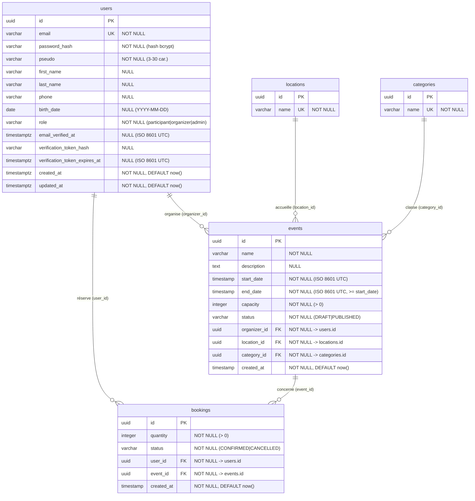

# ADR-002 : Modèle de données relationnel simplifié (5 tables)

- **Statut :** Accepté (2026-11-20) — Mis à jour (2026-11-24)
- **Décideurs :** Équipe EventHub (Arnaud, Claudia, Chloé, Kenzo, Robin)

## Contexte

Suite à la simplification vers une API REST unifiée NestJS et une base unique PostgreSQL 16 ([ADR-001](ADR-001-architecture-spa-api-unifiee.md)), ainsi qu'aux décisions fonctionnelles du [Contrat d'API v0.1](../../documentation/Contrat-API-v0.1-EventHub.md), l'ancien modèle éclaté sur trois bases distinctes est unifié.

Les dates d'événements sont standardisées au format horodatage ISO 8601 en UTC (`date-time`), tandis que les dates de naissance restent des dates sans heure (`YYYY-MM-DD`).

## Décision

Adopter un schéma relationnel unique dans PostgreSQL (`eventhub`) composé de **5 tables** gérées via TypeORM : `users`, `locations`, `categories`, `events` et `bookings`.

### Diagramme Entité-Relation (MLD)

### Correspondance BDD (snake_case) et Contrat d'API (camelCase)

- **remainingSeats :** Calculé dynamiquement par le Back-end (`events.capacity` moins la somme des `bookings.quantity` en statut `CONFIRMED`).
- **Horodatages ISO 8601 :** `events.start_date`, `events.end_date`, `users.email_verified_at`, `users.verification_token_expires_at`, `users.created_at`, `users.updated_at`, `events.created_at` et `bookings.created_at` sont en UTC (`date-time`).
- **Date sans heure :** `users.birth_date` (`date`) est exposée au format `YYYY-MM-DD`.

## Conséquences

- **Positives :** Intégrité référentielle native via clés étrangères PostgreSQL, transactions ACID sur les réservations et alignement complet TypeORM / OpenAPI / Front.
- **Négatives :** L'ajout futur de tarifs ou de catégories de billets nécessitera une migration dédiée hors MVP.
