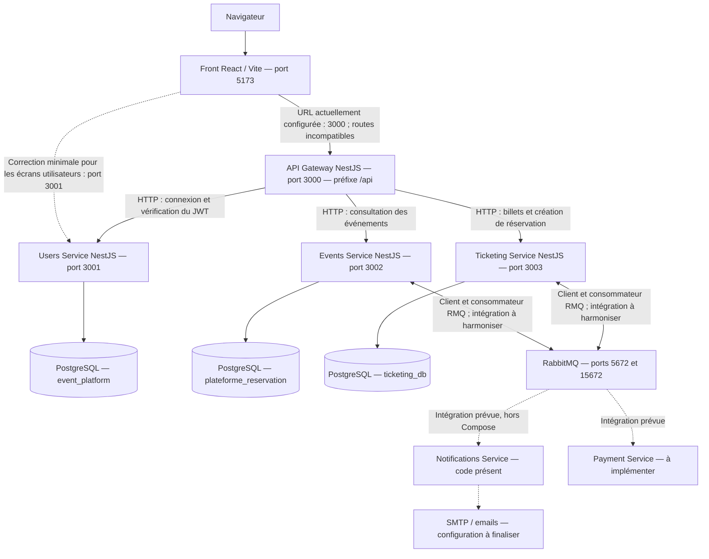

# Atelier 1 — Cartographier EventHub

Livrable : schéma d’architecture et tableau des écrans, données et endpoints.  
Projet analysé : `event-platform-main`.  
Date : 30 octobre 2026.

Ce document répond aux cinq consignes de la capture à partir du code du dépôt. Les six écrans recensés existent dans l’interface React. Les parcours événements et réservations sont disponibles côté API, mais leurs écrans restent à développer. Les choix proposés pour l’équipe sont distingués de l’implémentation actuelle.

## 1. Lister au moins cinq écrans d’EventHub

L’interface se trouve dans `services/users-service/ui`. Ses routes sont déclarées dans `src/App.jsx`.

| Écran existant | Route navigateur | Fichier React | Objectif |
| --- | --- | --- | --- |
| Connexion | `/login` | `src/pages/Login.jsx` | Authentifier un utilisateur |
| Inscription | `/register-user` | `src/pages/Register.jsx` | Créer un compte |
| Profil | `/profile` | `src/pages/Profile.jsx` | Consulter son compte |
| Administration | `/admin` | `src/pages/Admin.jsx` | Vérifier l’accès administrateur |
| Changement de mot de passe | `/reset` | `src/pages/Reset.jsx` | Modifier son mot de passe avec l’ancien |
| Gestion des utilisateurs | `/users` | `src/pages/Users.jsx` | Lister, créer et supprimer des utilisateurs |

La page d’administration actuelle affiche un message d’autorisation ; elle ne contient pas encore de tableau de bord métier. La page `/reset` nécessite une session et l’ancien mot de passe : ce n’est pas un parcours « mot de passe oublié ». Aucune page d’accueil n’est définie pour `/`.

## 2. Pour chaque écran : données affichées et actions possibles

| Écran | Données affichées ou saisies | Actions possibles | Données reçues du Back |
| --- | --- | --- | --- |
| Connexion | Champs email et mot de passe | Envoyer les identifiants, passer du thème clair au thème sombre | `access_token`, `refresh_token`, utilisateur `{ id, email, role }` ; le Front conserve le jeton d’accès, le rôle et l’email dans `localStorage` |
| Inscription | Email, mot de passe, rôle choisi parmi `participant` et `admin` | Créer un compte, puis aller à la connexion | Message de confirmation et utilisateur `{ id, email, role }` |
| Profil | Email, rôle et état de chargement | Consulter son profil ; redirection vers la connexion si la requête échoue | `{ id, email, role }` de l’utilisateur connecté |
| Administration | Message « Welcome ADMIN! » ou refus | Demander la vérification du rôle administrateur | `{ msg }` ou une erreur d’authentification/autorisation |
| Changement de mot de passe | Ancien mot de passe, nouveau mot de passe, message de résultat | Envoyer le changement du mot de passe | `{ message }` ou une erreur |
| Gestion des utilisateurs | Liste des emails et rôles ; formulaire email/mot de passe/rôle pour un administrateur | Charger la liste ; afficher le formulaire de création ; créer un compte ; confirmer et supprimer un compte | Liste de `{ id, email, role }`, résultat de création ou de suppression |

La barre de navigation permet de passer entre les six écrans et de se déconnecter en supprimant le jeton et le rôle locaux. Les boutons de création et de suppression de la liste sont affichés selon le rôle conservé dans le navigateur ; les autorisations doivent également être vérifiées par le serveur.

## 3. Déduire les endpoints candidats, avec producteur et consommateur

### 3.1 Endpoints correspondant aux écrans existants

Ces endpoints existent déjà dans le service utilisateurs. Les chemins ci-dessous sont relatifs à son URL locale : `http://localhost:3001` avec Docker Compose.

| Écran / besoin | Méthode et endpoint | Corps de la requête | Producteur de la réponse | Consommateur | Protection actuelle |
| --- | --- | --- | --- | --- | --- |
| Connexion | `POST /auth/login` | `{ email, password }` | Users Service — `AuthController` | Écran Connexion ; également API Gateway pour son propre parcours de connexion | Public ; vérification des identifiants |
| Inscription | `POST /users/register` | `{ email, password, role }` | Users Service — `UsersController` | Écran Inscription et formulaire de création de la liste utilisateurs | Public ; rôle fourni par le client |
| Profil | `GET /users/me` | Aucun | Users Service — `UsersController` | Écran Profil ; également API Gateway pour vérifier une session | JWT |
| Administration | `GET /users/admin` | Aucun | Users Service — `UsersController` | Écran Administration | JWT et rôle `admin` |
| Changement de mot de passe | `POST /users/reset-password` | `{ oldPassword, newPassword }` | Users Service — `UsersController` | Écran Changement de mot de passe | JWT et vérification de l’ancien mot de passe |
| Liste utilisateurs | `GET /users/all` | Aucun | Users Service — `UsersController` | Écran Gestion des utilisateurs | Gardes commentés dans le code : accès actuellement public |
| Suppression utilisateur | `DELETE /users/:id` | Aucun | Users Service — `UsersController` | Écran Gestion des utilisateurs | JWT et rôle `admin` |

Les requêtes protégées utilisent l’en-tête `Authorization: Bearer <access_token>`. Le service propose aussi `POST /auth/refresh` avec `{ refresh_token }`, mais l’interface actuelle ne l’utilise pas.

**Problème d’intégration constaté :** `ui/src/api.js` utilise actuellement `http://localhost:3000`, alors que les routes ci-dessus sont celles du service utilisateurs exposé sur `3001`. La passerelle utilise le préfixe `/api`, n’expose pas toutes les routes utilisateurs et ne configure pas CORS pour cette interface. Pour faire fonctionner les écrans existants avec Compose, la correction minimale est de diriger cette interface vers `http://localhost:3001`. Cette correction n’est pas appliquée par ce document.

### 3.2 Parcours métier à ajouter au Front

Les endpoints ci-dessous sont déjà présents dans les API ; les écrans consommateurs sont des propositions d’évolution.

| Écran proposé | Données et actions | Endpoint existant | Producteur | Consommateur prévu |
| --- | --- | --- | --- | --- |
| Catalogue d’événements | Afficher les événements publiés, sélectionner un événement | `GET /api/booking/events` | API Gateway, qui appelle Events Service | Futur catalogue React |
| Détail d’un événement | Afficher nom, description, dates, catégorie et lieu | `GET /api/booking/events/:id` | API Gateway, qui appelle Events Service | Futur écran de détail |
| Choix des billets | Afficher les types de billets d’un événement | `GET /ticket-types/event/:eventId` sur le port `3003` | Ticketing Service | Futur écran de réservation ; route à relayer dans la passerelle si celle-ci devient le point d’entrée unique |
| Réservation | Envoyer le type de billet, la quantité et les informations de réservation | `POST /api/booking/events/:id/book` | API Gateway, qui appelle Events Service puis Ticketing Service | Futur écran de réservation |
| Mes réservations | Consulter références, quantités, montants et statuts | `GET /bookings?userId=...` sur le port `3003` | Ticketing Service | Futur espace participant ; contrôle de propriété à ajouter côté serveur |

La réservation attend `{ userId, ticketTypeId, quantity, notes? }`. Les routes de réservation de la passerelle exigent une session. Pour ce parcours, la connexion existe à `POST /api/auth/login`. Les routes directes de billetterie n’ont pas de garde d’authentification dans leurs contrôleurs actuels.

## 4. Repérer trois dépendances Front vers Back et trois Back vers Front

« Front vers Back » signifie ici une information ou un contrat dont le Front a besoin du Back. « Back vers Front » signifie une donnée ou un comportement que le Back attend du Front. Les réponses HTTP restent des réponses à des requêtes : le projet ne met pas en place de notifications serveur vers le navigateur.

### Trois dépendances Front vers Back

| Dépendance | Exemple concret | Effet si le contrat n’est pas respecté |
| --- | --- | --- |
| F1 — Authentification | La page Connexion attend `access_token` et `user.role` dans la réponse de `POST /auth/login` | La session ne peut pas être enregistrée correctement |
| F2 — Chargement du profil | La page Profil dépend de `GET /users/me` pour obtenir l’email et le rôle | La page redirige vers `/login` si la requête échoue |
| F3 — Gestion des utilisateurs | La liste dépend de `GET /users/all` et de `DELETE /users/:id` | Impossible d’afficher une liste à jour ou de supprimer un compte |

### Trois dépendances Back vers Front

| Dépendance | Exemple concret | Attente du Back |
| --- | --- | --- |
| B1 — Transmission de la session | Le Front joint `Authorization: Bearer <token>` aux requêtes protégées | Recevoir un jeton valide pour identifier l’utilisateur |
| B2 — Contrat des données envoyées | Le formulaire de changement de mot de passe envoie `oldPassword` et `newPassword` ; l’inscription envoie `email`, `password`, `role` | Recevoir les noms de champs et valeurs attendus ; le serveur conserve la responsabilité de leur validation |
| B3 — Origine du navigateur | Le Front est servi depuis `http://localhost:5173` | Respecter l’origine autorisée par CORS dans Users Service ; un autre port ou `127.0.0.1` nécessite d’adapter cette configuration |

## 5. Choisir la pile de l’équipe : Front, Back et base

Choix proposé : conserver la pile déjà utilisée dans le dépôt pour concentrer le travail de l’équipe sur l’intégration et les fonctionnalités.

| Couche | Choix pour l’équipe | Justification |
| --- | --- | --- |
| Front | React 19 en JavaScript, Vite 7, React Router, Axios | Six écrans existent déjà ; routage et client HTTP sont en place |
| Back | Node.js et NestJS 11 en TypeScript | Services existants, modules, contrôleurs, validation et injection de dépendances |
| Base de données | PostgreSQL avec TypeORM | Modèles relationnels déjà définis ; bases distinctes pour utilisateurs, événements et billetterie |
| Communication asynchrone | RabbitMQ | Infrastructure déjà déclarée ; contrats et routage des événements à harmoniser |
| Exécution locale | Docker Compose pour les API et les bases ; Vite pour le Front | Correspond à l’organisation actuelle du projet |
| Authentification | JWT et bcrypt | Déjà utilisés dans Users Service ; contrôles de rôle à compléter |

Pour stabiliser l’environnement, l’équipe devra fixer les versions des images Node.js et PostgreSQL : les Dockerfiles utilisent actuellement `node:lts-alpine` et Compose utilise `postgres:alpine`.

## Schéma d’architecture

Le schéma distingue les appels actuellement écrits dans le code et le branchement direct à corriger pour les six écrans utilisateurs. L’interface React est lancée séparément : elle n’est pas déclarée dans Compose.

Les appels de la passerelle vers les services sont en HTTP. Les événements métier utilisent RabbitMQ. Le routage asynchrone n’est pas validé de bout en bout : Events Service publie par exemple `event.updated`, alors que Ticketing Service attend `EventUpdatedEvent`. Les notifications emploient également des contrats différents. Le montage de `definitions.json` dans RabbitMQ ne suffit pas, à lui seul, à configurer explicitement son import.

À terme, un point d’entrée unique via la passerelle est cohérent avec cette architecture. Cela demande d’y ajouter les routes utilisateurs manquantes, la configuration CORS et les routes métier nécessaires au Front.

## Points d’attention issus de l’analyse

- L’inscription publique permet actuellement de demander le rôle `admin`. Le choix de ce rôle doit être réservé à une opération autorisée côté serveur.
- La route `GET /users/all` a ses gardes commentés. Les routes directes événements et billetterie ne vérifient pas non plus les permissions dans leurs contrôleurs actuels.
- Le secret JWT et certaines configurations de base sont codés en dur ; plusieurs variables `.env` ne pilotent donc pas réellement ces valeurs.
- La réservation et la mise à jour du stock ne sont pas regroupées dans une transaction. Les réservations concurrentes et les annulations répétées nécessitent des contrôles supplémentaires.
- Le paiement n’est pas implémenté et les notifications ne sont pas lancées par Compose. Le parcours réservation, paiement et email reste incomplet.

## Restitution orale — trois minutes

| Temps | Message à présenter |
| --- | --- |
| 0:00–0:40 | EventHub vise la gestion d’événements et de réservations. Le Front actuel comprend six écrans : connexion, inscription, profil, administration, changement de mot de passe et utilisateurs. |
| 0:40–1:20 | Présenter le tableau écrans/données/actions. Exemple : la connexion envoie les identifiants, reçoit un JWT, puis le profil charge l’utilisateur connecté. |
| 1:20–2:00 | Présenter le schéma : React, passerelle NestJS, trois services avec leurs bases PostgreSQL et RabbitMQ pour les événements métier. Paiement et notifications restent à intégrer. |
| 2:00–2:35 | Expliquer les dépendances : réponses et disponibilité des API pour le Front ; jeton, champs et origine autorisée attendus par le Back. Signaler le mauvais port configuré dans le Front. |
| 2:35–3:00 | Annoncer la pile retenue : React/Vite, NestJS/TypeScript, PostgreSQL/TypeORM, RabbitMQ et Docker Compose. Priorités : corriger le branchement, sécuriser les rôles et harmoniser les contrats. |

## Sources dans le dépôt et portée de la vérification

- [Routes de l’interface](../services/users-service/ui/src/App.jsx)
- [Écrans React](../services/users-service/ui/src/pages/)
- [Client Axios](../services/users-service/ui/src/api.js)
- [Contrôleur utilisateurs](../services/users-service/src/users/users.controller.ts)
- [Contrôleur d’authentification](../services/users-service/src/auth/auth.controller.ts)
- [CORS du service utilisateurs](../services/users-service/src/main.ts)
- [Contrôleur de réservation de la passerelle](../services/api-gateway/src/modules/booking/booking.controller.ts)
- [Clients HTTP de la passerelle](../services/api-gateway/src/clients/)
- [Service événements](../services/events-service/src/events/events.service.ts)
- [Service de réservation](../services/ticketing-service/src/bookings/bookings.service.ts)
- [Contrats RabbitMQ de billetterie](../services/ticketing-service/src/rabbitmq/rabbitmq.service.ts)
- [Définitions RabbitMQ](../infra/event-broker/config/definitions.json)
- [Configuration Docker Compose](../docker-compose.yml)
- [Scripts du projet](../package.json)

La vérification TypeScript des quatre API a réussi, ainsi que `docker compose config --quiet`. Le moteur Docker Desktop ne répondait pas pendant l’analyse : le démarrage complet et les parcours navigateur n’ont pas été validés en exécution. Ce document constitue une cartographie du code et de sa configuration, avec les écarts constatés ; il ne modifie pas l’application.
